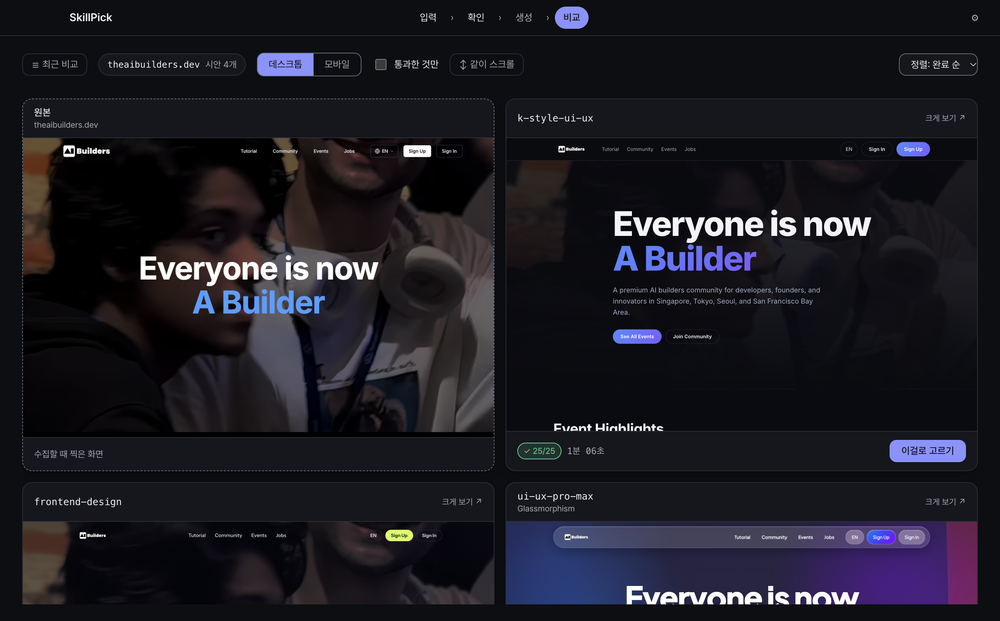

# SkillPick

자기 서비스를 직접 만드는 개발자가 홈페이지 디자인 스킬 여러 개를 URL 하나로 동시에 돌려 결과를 나란히 보고 고르게 해 주는 데스크톱 앱입니다

**Demo:** TODO 데모 영상 링크를 여기에 적습니다 (영상은 박태영이 녹화한 뒤 추가)



---

## 1. 문제 정의

### 대상 사용자
자기 서비스를 직접 만드는 개발자와 1인 창업자

### 문제 상황
홈페이지를 새로 꾸미거나 고칠 때마다 어떤 디자인으로 갈지 고민합니다(상황). 공개된 디자인 스킬이 많아서 무엇을 쓸지 고르지 못하고, 하나씩 돌려 보면 시간이 쌓입니다(불편). 결과를 비교하려면 시안마다 원본의 문구·가격·버튼·링크가 그대로 들어갔는지 사람이 눈으로 확인해야 합니다(불편).

### 기존 방식과 한계
스킬을 하나 골라 AI에게 시키고, 마음에 안 들면 다른 스킬로 바꿔 다시 시킵니다. 이 방식은 한 번에 하나만 보게 되어 나란히 비교할 수 없습니다. 시안이 가격을 빼먹거나 없던 숫자를 만들어도 눈으로 찾기 전에는 알 수 없습니다.

### 근거
이 불편이 얼마나 흔한지 보여 주는 설문이나 통계는 아직 모으지 않았습니다. 지금 근거는 작성자 본인이 겪은 경험뿐입니다. 이 프로젝트가 직접 잰 값은 아래 4번에 있습니다.

### 목표
URL 하나와 스킬 여러 개를 주면 시안이 동시에 만들어지고, 각 시안이 원본의 지켜야 할 것을 담았는지 앱이 자동으로 검사해서 비교 화면에 표시합니다. 사용자는 결과를 보고 고르기만 합니다.

---

## 2. 핵심 기능

| 기능 | 해결하는 불편 | 코드 위치 |
|---|---|---|
| 원본 수집: 주소를 넣고 Enter를 누르면 자동으로 시작. 제목·소제목·첫 단락·버튼(글자와 링크)·가격·내비를 읽고 1440·390 폭으로 캡처. 캡처 전에 끝까지 내려갔다 올라와 지연 로딩을 끝내고, 캡처 동안만 고정·sticky 요소를 풀고 건너뛰기 링크를 숨김(캡처 뒤 원복) | 원본에서 무엇을 지켜야 하는지 손으로 정리하는 일 | `src/main/capture.js`, `src/main/shoot.js`, `src/core/shotPrep.js`, `src/core/extract.js` |
| 지켜야 할 것 선정: 종류별로 최대 25개를 고르고 체크로 뺄 수 있음. 확인 화면에서 종류별로 접고 펼치며, 종류별·전체로 선택/해제하고, 수집한 에셋(이미지·로고·아이콘·SVG·영상) 개수를 보여 줌 | 시안이 담아야 할 기준이 없음 | `src/core/mustKeep.js`, `src/core/confirmView.js`, `renderer/screens/confirm.js` |
| 동시 실행: 스킬마다 Kiro CLI를 따로 띄워 같은 시각에 시안을 만듦. 동시 수는 설정으로 1~6 | 하나씩 돌려 보느라 드는 시간 | `src/main/engine.js`, `src/main/runner.js` |
| 자동 검사: 지켜야 할 것 포함 여부, 외부 스크립트, 외부로 보내는 폼, 원본에 없는 숫자, 파일 크기 | 빠뜨리거나 지어낸 시안을 눈으로 찾는 일 | `src/core/checker.js` |
| 빠진 항목 다시 고치기: 검사에서 빠지면 같은 세션에서 한 번 더 시킴 | 빠진 시안을 버리거나 손으로 고치는 일 | `src/main/runner.js` |
| 비교 격자: 원본과 시안을 실제로 그려 나란히 보여 줌. 창 크기와 상관없이 2열 고정이고 원본이 첫 칸. 카드마다 스킬명과 스타일명, 검사 배지, 시간, `이걸로 고르기` 버튼이 있어 크게 보기를 거치지 않고 바로 고름. 데스크톱/모바일 전환, 통과한 것만 보기, 정렬, `같이 스크롤`, 사이드바 접기 | 결과를 한눈에 비교하지 못함 | `renderer/screens/compare.js`, `src/core/compareView.js` |
| 크게 보기와 가져가기: 검사 결과 패널, 원본과 나란히, HTML 저장, Kiro 규칙으로 내보내기 | 고른 뒤 쓰는 방법 | `renderer/screens/detail.js`, `electron/ipc.js` |
| 스킬 목록: 공개 GitHub에서 실제로 열어 확인한 스킬 6개, SKILL.md 주소로 직접 추가 | 어떤 스킬이 있는지 모름 | `src/core/skills.js`, `src/main/skillFetch.js` |
| 스킬 안의 스타일 고르기: 스킬이 스타일 목록을 갖고 있으면(지금은 `ui-ux-pro-max`의 51개) 고른 스타일마다 시안 하나. 한 번에 시안 12개까지 | 한 스킬에 여러 스타일이 있는데 하나로만 나옴 | `src/core/styles.js`, `renderer/screens/newRun.js` |
| 원본 에셋 수집: 이미지, 배경, 영상, 인라인 SVG, 로고, 파비콘을 역할과 가까운 제목과 함께 모아 시안에 줌 | 시안이 원본 사진과 로고를 못 쓰거나 엉뚱한 곳에 씀 | `src/core/extract.js`, `src/main/workspace.js` |

## 3. 사용 시나리오

1. 앱을 열고 홈페이지 주소를 넣습니다. Enter를 누르거나 입력칸을 벗어나면 원본 수집이 바로 시작되고, 그동안 스킬을 고릅니다 (기본은 세 개가 선택되어 있고 하단 바에 `3개 선택 · 시안 3개 · 동시 3개`가 보입니다)
2. `원본 확인`에서 앱이 읽은 지켜야 할 것 목록과 에셋 요약을 보고, 빼고 싶은 항목을 해제한 뒤 `시안 n개 만들기`를 누릅니다
3. 생성 화면에서 스킬별 상태와 경과 시간, Kiro 출력 마지막 줄이 실시간으로 보입니다
4. 끝나면 비교 화면에서 원본과 시안을 2열로 나란히 보고, 배지(`✓ 25/25`)와 경고 꼬리표로 통과 여부를 확인합니다. `같이 스크롤`을 켜면 한 카드를 내릴 때 다른 카드도 같은 비율로 내려갑니다
5. 카드의 `이걸로 고르기`를 누르거나 크게 보고 `이 스킬로 고르기`를 눌러 출처 복사, HTML 저장, Kiro 규칙 파일 내보내기 중 필요한 것을 합니다

## 4. 기대 효과

아래 값은 한 사이트에서 한 번 잰 결과입니다. 다른 사이트나 다른 날에는 달라질 수 있습니다.

- 대상: `theaibuilders.dev`, 스킬 `frontend-design`, `k-style-ui-ux`, `ui-ux-pro-max` 세 개
- 세 시안이 만들어지는 데 걸린 시간: 시작부터 모두 끝날 때까지 65초 (화면 관찰값)
- Kiro CLI 실행 시간: 각각 58.2초, 47.9초, 43.6초. 세 프로세스는 12밀리초 안에 시작했고 43.6초 동안 같이 돌았습니다
- 한 개씩 돌린다고 가정하면 Kiro CLI 시간만 더해도 149.7초입니다 (위 세 값의 합, 직접 순차 실행해 잰 값은 아닙니다)
- 세 시안 모두 지켜야 할 것 25개 중 25개를 담았고 다시 고치기는 0번 일어났습니다

## 5. 차별점

- 스킬 하나를 쓰는 도구가 아니라 스킬 여러 개를 같은 조건에서 동시에 돌리고 한 화면에서 비교합니다
- 비교 기준(지켜야 할 것)을 원본에서 자동으로 뽑고, 통과 여부는 AI 판단이 아니라 코드(`src/core/checker.js`)로 계산합니다
- 비교 화면의 시안은 실제로 그려진 결과이고, 미리 만든 결과를 재생하지 않습니다. 시작과 끝 시각은 `timeline.log`에 남습니다

---

## 6. 설치와 실행

준비물: Node.js 24, [Kiro CLI](https://kiro.dev) 설치와 로그인

```bash
# 1. 의존성 설치
npm install

# 2. Kiro CLI 설치와 로그인 (아직 없을 때)
curl -fsSL https://cli.kiro.dev/install | bash
kiro-cli login

# 3. 실행
npm start
```

앱을 처음 열면 Kiro CLI 설치와 로그인 상태를 확인하는 화면이 나옵니다.

## 7. 테스트

```bash
npm test
```

판정 로직(추출, 지켜야 할 것 선정, 검사, 상태 전이, 동시 실행 풀, 프롬프트)을 `node --test`로 시험합니다. 2026-11-14 기준 172개가 통과했습니다. 시안을 만드는 실제 Kiro CLI는 시험하지 않고, 가짜 명령(`tests/fixtures/fake-kiro.js`)으로 동시 수 제한과 시간 초과를 시험합니다.

---

## 알려진 한계

- **폴더 밖 접근은 막지 못합니다.** 비대화 실행에 `--trust-tools=fs_read,fs_write`를 주면 Kiro CLI가 작업 폴더 밖 파일도 읽고 쓸 수 있다는 것을 이 환경에서 확인했습니다(Kiro CLI 3.1.0과 3.3.0). 셸 실행 도구는 신뢰 목록에 넣지 않아 명령 실행은 막혀 있습니다. 원본 페이지에서 뽑은 글자는 데이터로만 다루고 지시문에 폴더 범위를 적었지만, 이것은 강제 장치가 아닙니다. 결과는 `out/index.html`만 읽습니다
- **전역 설정이 시안에 섞일 수 있습니다.** 이 환경에서는 사용자 전역 steering과 스킬이 작업 폴더의 Kiro 실행에도 같이 들어왔고 끌 방법을 찾지 못했습니다
- **스타일 고르기는 `ui-ux-pro-max`만 됩니다.** 스킬 저장소에서 스타일 목록을 파일로 읽을 수 있는 것은 이 스킬뿐이어서입니다. 나머지 스킬과 직접 추가한 스킬은 스킬 하나가 시안 하나이고, 스킬이 정하는 방향은 매번 달라질 수 있습니다
- 스킬의 스크립트와 데이터 파일은 여전히 쓰지 않습니다. `ui-ux-pro-max`는 스타일 목록의 한 행(키워드, 색, 효과, 점검표 등)만 시안에 들어갑니다
- 에셋은 원본 주소를 그대로 불러 씁니다(내려받지 않음). 원본 서버가 다른 사이트의 이미지 요청을 막으면 시안에서 이미지가 안 보일 수 있습니다. 시안이 `assets.json`에 없는 이미지 주소를 쓰는지는 검사하지 않습니다
- `같이 스크롤`은 화면 안에서 보낸 휠 이벤트(DevTools 프로토콜)로 비율이 맞는 것까지만 확인했습니다. 실제 마우스 휠이나 트랙패드로는 확인하지 못했습니다
- 창 제어 버튼(신호등)과 `SkillPick` 글자는 겹치지 않게 간격을 계산해 두었고(글자 시작 100px, 버튼은 이 맥에서 잰 20~80px) 이 값은 확인했지만, 실제 창을 화면 캡처해 눈으로 보지는 못했습니다. 이 환경의 화면 캡처가 검은 화면으로 나왔습니다
- 비교 화면 스크린샷(`docs/screens/`)은 새 화면으로 다시 찍었지만, 생성 중 화면(`04-running.png`, `04b-running-done.png`)은 이전 모습 그대로입니다. 다시 찍으려면 Kiro CLI를 실제로 돌려야 해서 이번에는 하지 않았습니다
- 다시 고치기는 가짜 명령으로 시험했고, 실제 Kiro CLI로 다시 고치기가 일어나는 경우는 아직 관찰하지 못했습니다
- `HTML 저장`과 `내 프로젝트에 내보내기`의 폴더·저장 대화상자는 직접 눌러 확인하지 못했습니다
- 예비 엔진(Anthropic API)은 만들지 않았습니다

---

## 팀

- **팀 번호:** team-036 (저장소 폴더 이름 기준, 명찰 번호와 대조 필요)
- **팀명:** 태지로

| 이름 | 역할 |
|---|---|
| 박태영 | 1인 개발: 기획, 설계, 구현 확인 |
